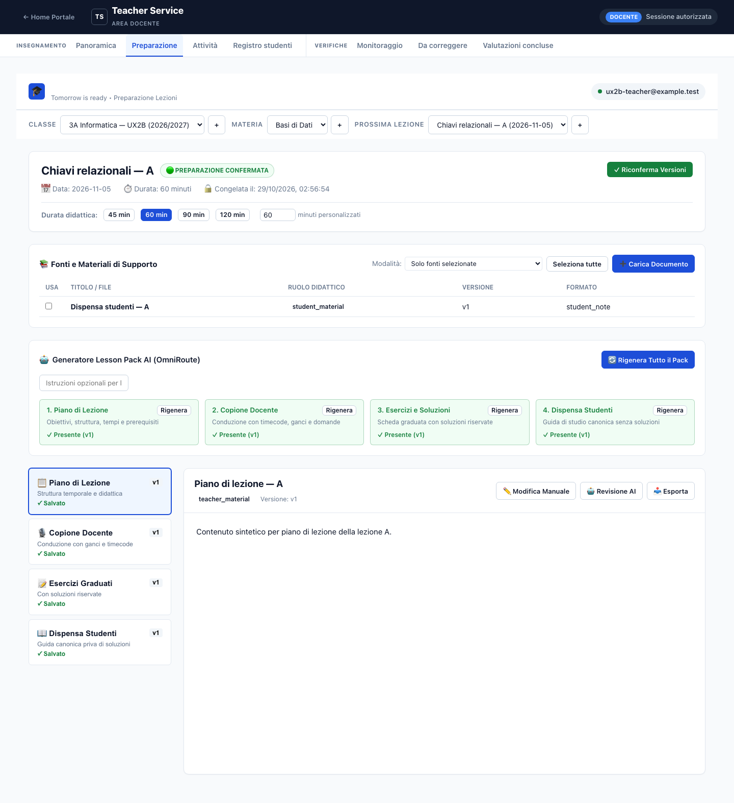
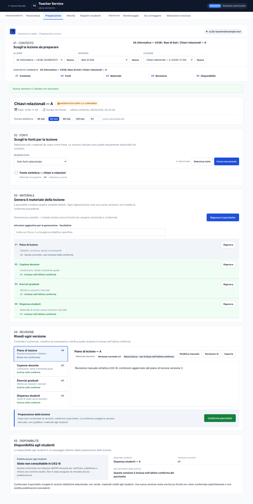
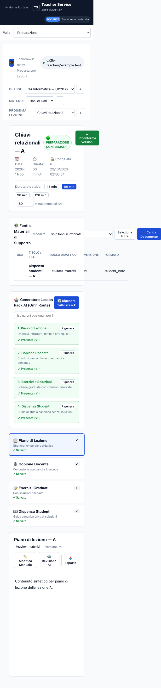
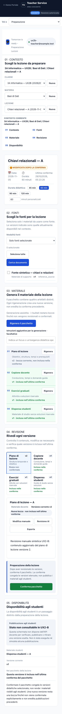
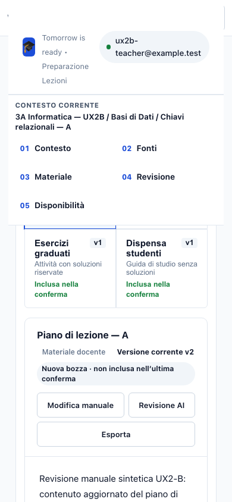
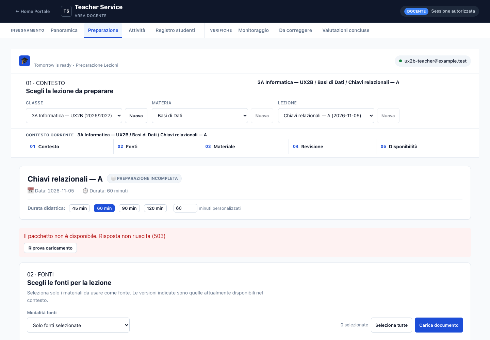
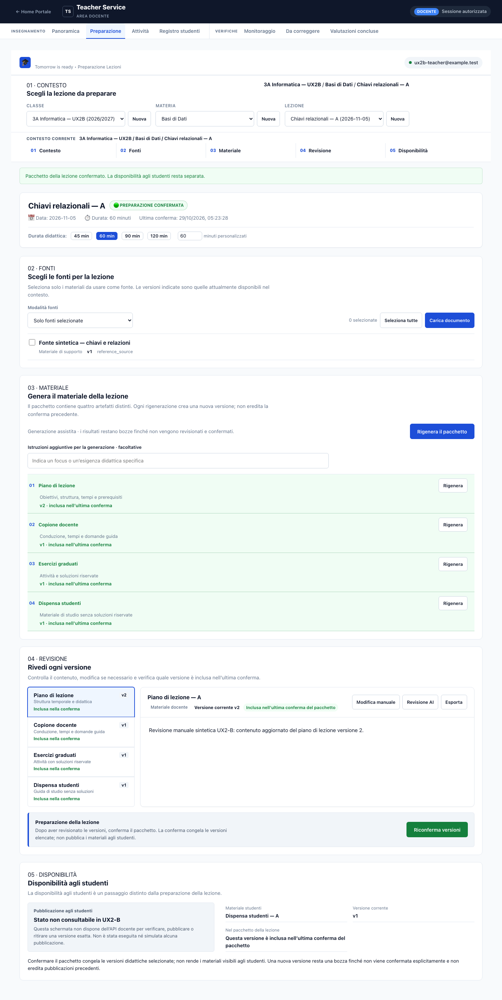

# UX2-B — Teacher Preparation Flow Report

**Data:** 29 ottobre 2026 (Europe/Rome)  
**Stato:** completato localmente, in attesa di revisione; nessun push, merge o deployment.  
**Branch:** `codex/teacher-service-c6`  
**Direzione:** B — Console operativa docente; direzione A — Studio didattico studenti resta l’indirizzo futuro del design system condiviso.

## Sintesi

È stato organizzato il percorso docente in cinque fasi: **Classe → Materia → Lezione → Fonti → Materiale → Revisione → Disponibilità**. Il flusso conserva il linguaggio blu/slate esistente, senza riscrivere l’area docente né creare una seconda libreria UI.

Classe, materia e lezione restano visibili durante la navigazione. Cambi di contesto che rischiano di scartare modifiche chiedono una decisione esplicita. Versione corrente, nuova bozza e versioni incluse nell’ultima conferma sono distinte. La conferma congela le versioni esatte della preparazione e **non** pubblica i materiali agli studenti. Poiché manca una REST API docente per leggere o modificare la disponibilità di una versione, la schermata dichiara che lo stato non è consultabile e non simula la pubblicazione.

## 1. Problemi risolti

| Problema | Intervento ed evidenza |
|---|---|
| Contesto perso nel flusso | Riepilogo persistente e indice sticky; test verifica contesto e selezioni dipendenti durante cambio classe e scroll. |
| Perdita di bozze durante il cambio di contesto/materiale | Dialogo esplicito per annullare o scartare e continuare; test verifica entrambe le scelte. |
| Ambiguità tra nuova versione e ultima conferma | Etichette chiare; conferma collocata dopo la revisione. Il test crea v2, la distingue come bozza, poi verifica che la conferma includa esattamente v2. |
| Conferma scambiata per pubblicazione | Conferma e disponibilità hanno testi e stati separati. Dopo la conferma il test legge zero righe in `material_publication_events` e nessuna richiesta `publish`/`unpublish`. |
| Errore di caricamento senza recupero | Errore 503 sintetico visibile e pulsante “Riprova caricamento”; il retry viene verificato. Screenshot dedicato sotto. |
| Workspace di revisione troppo alto | La vista read-only non riserva l’altezza intera dell’editor; test misura il workspace. |
| Overflow e controlli larghi su smartphone | Lista e revisione diventano layout impilati; disponibilità e dettagli sono su una colonna al breakpoint mobile. Test: nessun overflow a 390 px e asserzioni sulla griglia responsive. |

**Rilevazione iniziale non riprodotta:** una critica indipendente ha segnalato la griglia Disponibilità come stretta su mobile leggendo soltanto la regola desktop (`minmax(18rem, 1fr)`). La verifica del breakpoint `max-width: 760px` mostra invece un’unica colonna. La suite ora asserisce anche questo comportamento; nessuna correzione CSS è stata necessaria.

## 2. Componenti e perimetro

Principali file UX2-B:

- `client/src/components/PreparationFlow.js` — indice delle fasi e contesto persistente.
- `client/src/components/TeacherPreparationView.js` — composizione del percorso.
- `ContextBar.js`, `LessonHeader.js`, `SourceManager.js` — contesto e fonti.
- `StepProgressCard.js`, `ArtifactWorkspace.js` — versioni, stati e revisione.
- `Modals.js` — conferma delle versioni e protezione delle modifiche non salvate.
- `client/app.css` — layout responsive e componenti, nello stesso sistema di stili.

`PRODUCT.md` e `DESIGN.md` documentano il prodotto verificabile e il design system condiviso: palette blu/slate esistente, docente B e futura presentazione studenti A. Non sono stati modificati servizi, API, database, autenticazione, MCP, scoring, logica delle verifiche o pubblicazioni.

## 3. Screenshot prima/dopo

Le schermate “prima” sono le evidenze UX2-A conservate; quelle “dopo” sono state rigenerate con Chromium e fixture UX2-B sintetiche. Sono confrontabili per orientamento e contesto, non pixel-per-pixel: il flusso nuovo espone più fasi. La schermata mobile “prima” è larga 672 px con viewport 390 px (overflow); quella “dopo” resta 390 px. La pagina nuova è più lunga (4434 px full-page) perché esplicita le fasi e gli stati.

### Desktop 1440 px

| Prima | Dopo |
|---|---|
|  |  |

### Smartphone 390 px

| Prima | Dopo |
|---|---|
|  |  |







## 4. Verifica browser e accessibilità

Suite Playwright su Chromium reale headless, servizio HTTP locale, database temporaneo, AI mockata e soli dati sintetici. Viewport:

- Desktop: 1440×1000.
- Tablet: 768×1024.
- Mobile con touch emulation: 390×844.

Verificati overflow orizzontale, impilamento della revisione, contesto sticky, cambio selezioni, guardia delle bozze, errore/retry, versioni e conferma, navigazione via tastiera, focus visibile e due campioni di contrasto informativo ≥4,5:1. Questi controlli non certificano l’intera UI WCAG. Non sono stati usati dispositivi fisici né screen reader; il flusso non è stato verificato a 320/1024 px o con zoom 200%.

Limiti visivi rimasti: il percorso è lungo su mobile; la barra sticky occupa una parte importante del viewport durante lo scroll. I cinque link sono un indice di salto, ma non indicano dinamicamente fase corrente/completata e non impostano `aria-current`.

## 5. Impeccable e audit

Skill già installata, **Impeccable 4.8.0**, non reinstallata né aggiornata.

Comandi effettivamente eseguiti:

1. `impeccable context` e `impeccable context --target client/src/components/PreparationFlow.js`.
2. `impeccable detect --json --scope layout` su `client/app.css` e i 12 componenti docente modificati: **0 finding**.
3. `impeccable detect --json` sugli stessi target: **355 finding su file interi** — 9 warning `side-tab`, 218 advisory `design-system-font-size`, 42 advisory `design-system-radius`, 86 advisory `design-system-color`.

La CLI disponibile espone `detect`, non i comandi `audit` o `critique`. Sono stati consultati i riferimenti Impeccable `audit.md` e `critique.md`: la revisione qualitativa indipendente ha considerato codice e screenshot; la checklist tecnica è stata applicata manualmente. I warning `side-tab` verificati sono accenti intenzionali di quote/callout/stati. Gli advisory sono scansioni di file interi e non distinguono con precisione valori ereditati dalle aggiunte UX2-B; non sono state aggiunte regole ignore. Il detector non certifica contrasto complessivo, WCAG o qualità visiva.

**Rubrica tecnica indicativa Impeccable (0–4):** Accessibilità 3; Prestazioni 3; Theming 3; Responsive 3; Integrità implementativa 3. **Totale 15/20 — Buono**, limitato al percorso UX2-B. Bundle client: 436,51 kB (120,38 kB gzip); CSS: 88,18 kB (15,70 kB gzip). Non è stato eseguito profiling runtime su dispositivo.

## 6. Test e regressioni

- `UX2B_SCREENSHOTS_DIR=.impeccable/ux2/screenshots pnpm run test:browser:ux2b` — **1 passato, 0 falliti, 0 skip**; build client inclusa e superata.
- `pnpm run test:browser:c5` — **1 passato, 0 falliti, 0 skip**.
- `pnpm test` — **37 suite passate, 0 fallite**. Rerun finale con accesso loopback: test T1 container e flusso studente sintetico entrambi passati.
- Il test UX2-B controlla che la conferma non crei eventi di pubblicazione e non invii richieste di pubblicazione.
- Nessun test usa dati reali o contatta la produzione.

## 7. Dipendenza REST residua — proposta, non implementata

`TeacherService` espone già `publishMaterial`/`unpublishMaterial`; `src/server/http.js` non espone le corrispondenti rotte REST docente. Proposta per il checkpoint API:

```http
GET    /api/materials/{materialId}/versions/{versionNumber}/publication
POST   /api/materials/{materialId}/versions/{versionNumber}/publication
DELETE /api/materials/{materialId}/versions/{versionNumber}/publication
```

- Richiedere un principal **esplicitamente autorizzato come docente**; autenticazione da sola non basta. L’attore dell’evento viene dal principal sul server, mai dal payload.
- La versione nel path è un intero positivo ed esatto; niente fallback alla versione corrente né override nel body.
- `POST` accetta `availableUntil` futuro (RFC 3339) e `notes` opzionali, e restituisce lo stato/evento della versione esatta. `DELETE` registra il ritiro per la stessa versione senza cancellare la cronologia.
- `GET` restituisce lo stato effettivo per versione (non pubblicato, disponibile, scaduto o ritirato), evitando che la UI deduca la pubblicazione dalla conferma della lezione.
- Conservare i controlli di dominio: materiale attivo, ruolo `student_material` o `support_material`, esclusione `lesson_plan`, `teacher_script`, `assessment`, validità di `availableUntil`. Concordare mapping HTTP e idempotenza prima di implementare.
- La conferma del pacchetto non invoca le rotte. Nuove versioni non ereditano approvazione o pubblicazione.

**UX2-B non implementa né simula questo contratto.** Prima di aggiungere pulsanti “pubblica/ritira”, sottoporre il contratto al Domain Owner e implementare/validare le rotte con test di autorizzazione e version-binding.

## 8. Rischi e backlog

1. **P1 — Dipendenza di prodotto:** stato e azioni di disponibilità richiedono la REST API docente; per ora la UI indica correttamente il limite.
2. **P2 — Mobile:** compattare la barra sticky durante lo scroll e aggiungere fase attiva senza coprire i contenuti.
3. **P2 — Flusso lungo:** valutare riepiloghi/collasso delle fasi già completate senza perdere contesto o accesso ai dettagli.
4. **P3 — Copertura:** aggiungere 320/1024 px, zoom 200%, tastiera completa, screen reader, Chrome grafico e dispositivi fisici.
5. **P3 — Manutenzione:** armonizzare progressivamente i valori CSS ereditati ai token senza regressioni sulle superfici esistenti.

## 9. Chiusura

UX2-B è completato nel perimetro approvato. Restano revisione supervisore/Domain Owner e contratto REST docente. Nessun push, merge o deployment. Il commit locale sarà riportato nel riepilogo di consegna.
