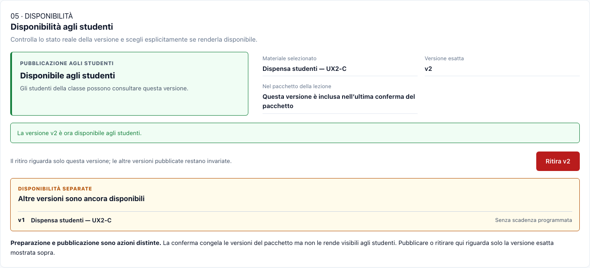
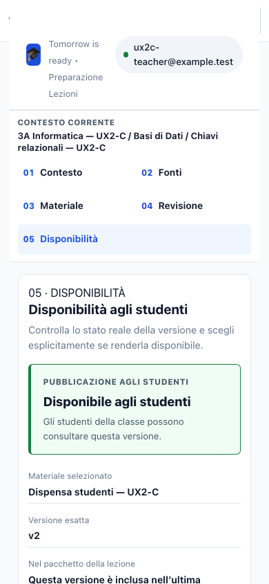

# UX2-C — Version-Bound Publication Integration Report

**Data:** 29 ottobre 2026 (Europe/Rome)
**Esito:** **PASS — implementazione e verifica locali**
**Branch:** `codex/teacher-service-c6`
**Commit base:** `5ba6b97cb6da03b5f1438d8b1fd81e01a0c6ae3c` (UX2-B)
**Produzione:** non modificata; nessun push, merge, deploy o pubblicazione di materiali reali.

## Sintesi

La fase **Disponibilità** del percorso di preparazione ora legge e modifica lo stato reale della versione selezionata tramite API docente version-bound. La conferma della preparazione resta distinta dalla pubblicazione; nessuna chiamata di scrittura parte all’apertura della schermata, al salvataggio o alla conferma del pacchetto. Il portale studenti continua a mostrare soltanto versioni effettivamente pubblicate e disponibili secondo il lifecycle esistente.

L’implementazione riusa `MaterialService` per regole e persistenza, conserva gli eventi append-only e non introduce una nuova architettura. Test e screenshot utilizzano dati, database, FileStore e identità sintetici, isolati dal servizio produttivo.

## 1. Contratto REST

Le tre operazioni sono state aggiunte sul percorso esatto della versione:

```http
GET    /api/materials/:materialId/versions/:versionNumber/publication
POST   /api/materials/:materialId/versions/:versionNumber/publication
DELETE /api/materials/:materialId/versions/:versionNumber/publication
```

- `versionNumber` deve essere una rappresentazione intera positiva, sicura ed esatta (`[1-9]\d*`). Non esiste fallback alla versione corrente. Una versione o risorsa inesistente restituisce `404`.
- `GET` restituisce `{ publication }`. L’oggetto contiene un descrittore minimo della risorsa/versione, `status`, `isAvailable`, `canPublish`, `canUnpublish`, date di pubblicazione/scadenza/ritiro, un eventuale `blockedReason` e le altre versioni disponibili. Non include contenuto, attore o note dell’evento.
- `POST` accetta `availableUntil` facoltativo (`null` o stringa interpretabile come data futura); se omesso/null la disponibilità non ha scadenza programmata. I campi sconosciuti e i campi di identità lato client sono rifiutati. Prima pubblicazione: `201` con `outcome: "published"`; ripetizione equivalente mentre la versione è già disponibile: `200` con `outcome: "already_available"`.
- `DELETE` non accetta campi di input: ritira solo la versione nel percorso. Ritiro effettivo e ripetizione dopo un ritiro già registrato restituiscono `200` con `withdrawn` / `already_withdrawn`; un ritiro di una versione mai pubblicata o non più disponibile per scadenza restituisce `409`.
- Errori coerenti: `400` per versione/payload non validi o materiale non idoneo, `401` senza autenticazione, `403` per principal non autorizzato o CSRF non valido, `404` per risorsa/versione assente, `409` per conflitto di stato.

## 2. Autenticazione e autorizzazione

Le rotte passano dalla protezione REST docente esistente: autenticazione valida **e** autorizzazione applicativa esplicita del principal tramite il teacher-authorizer. L’autenticazione da sola non concede privilegi docente. Le mutazioni POST/DELETE passano dal controllo CSRF condiviso; il preflight CORS include DELETE. `publishedBy` e `unpublishedBy` sono valorizzati esclusivamente sul server dal principal autenticato e i corrispondenti campi client sono respinti.

Il servizio consente soltanto i ruoli già idonei (`Student Material` e `Support Material`) e rifiuta `Teacher Material` e le risorse di tipo `Teacher Script`, `Lesson Plan` o `Assessment`. Le soluzioni marcate teacher-only restano filtrate nella risposta studente.

## 3. Semantica di stato e versioni

| Stato | Significato |
|---|---|
| `never_published` | Nessun evento di pubblicazione per la versione esatta. |
| `available` | L’ultimo evento valido è una pubblicazione non scaduta e il materiale è ancora eleggibile/attivo. |
| `expired` | La scadenza è passata; la cronologia non viene riscritta e il portale non restituisce la versione. |
| `withdrawn` | L’ultimo evento della versione è un ritiro. |
| `unavailable` | Esiste una pubblicazione storica ma vincoli correnti (per esempio materiale inattivo o ruolo cambiato) impediscono la disponibilità. |

Gli eventi sono append-only. La ripetizione con lo stesso stato e la stessa scadenza non crea eventi ridondanti; una ripubblicazione con scadenza diversa registra invece un nuovo evento. Pubblicare v2 non ritira v1 e non la rende implicitamente disponibile; ritirare una versione non altera le altre. Il GET segnala le altre versioni che restano attualmente disponibili. La conferma del pacchetto non produce eventi di pubblicazione.

## 4. UI e verifica visuale

Il pannello UX2-C mostra nome del materiale, versione esatta, stato API, inclusione della versione nell’ultima conferma del pacchetto, scadenza e altre versioni disponibili. Pubblica e Ritira richiedono conferma esplicita; il ritiro dichiara che riguarda soltanto la versione selezionata. Errori e stati di caricamento non vengono presentati come disponibilità affidabile; sono presenti retry e recupero dei conflitti. La selezione della scadenza usa l’ora locale dell’input e invia un istante ISO in UTC. La conferma porta il focus al controllo principale e le azioni usano pulsanti nativi e label associate.

Verifica manuale degli screenshot desktop/tablet/mobile e del portale studente. Detector Impeccable 4.8.0: `detect client/src/components/PreparationFlow.js client/app.css --scope layout --json` → `[]` (nessun finding di layout). Il risultato automatico non è una certificazione WCAG; la verifica responsive e di gerarchia è stata anche visuale.





Altre evidenze:
- [Bozza v2 e v1 ancora disponibile — desktop](screenshots/draft-v2-and-available-v1-1440.png)
- [Disponibilità — tablet 768 px](screenshots/published-v2-with-v1-tablet-768.png)
- [Versione v2 visibile nel portale studente](screenshots/student-v2-visible-1440.png)
- [v2 ritirata, v1 ancora disponibile](screenshots/withdrawn-v2-with-v1-desktop-1440.png)

## 5. Test e regressioni

Verifiche locali finali:

- `node --test tests/server/material-publication-api.test.js`: **10 test passati, 0 falliti**. Include GET mai pubblicata, versioni invalide/inesistenti, identità anonima e autenticata non docente, CSRF e preflight DELETE, idoneità Student/Support Material e rifiuto di Teacher Material/Teacher Script/Lesson Plan/Assessment, date non valide/passate, attore server-side, idempotenza, conferma separata, visibilità studente, filtro soluzioni, versioni indipendenti e scadenza.
- `UX2C_SCREENSHOTS_DIR=.impeccable/ux2c/screenshots pnpm run test:browser:ux2c`: **1 percorso browser passato, 0 falliti, 0 skip**; build client superata. Copre 503 con retry, conflitto 409, revisione e passaggio a v2, conferma senza nuovo evento, pubblicazione esplicita, verifica studente e ritiro di v2 mantenendo v1 disponibile.
- `UX2B_SCREENSHOTS_DIR=.impeccable/ux2/screenshots pnpm run test:browser:ux2b`: **1 passato, 0 falliti, 0 skip**.
- `pnpm run test:browser:c5`: **1 passato, 0 falliti, 0 skip**.
- `pnpm test`: **38 suite passate, 0 suite fallite**.
- Le esecuzioni browser hanno completato la build client; nessun output generato `client/dist` è incluso nelle modifiche.
- `git diff --check`: nessun errore di whitespace.

## 6. File modificati

- `client/app.css`
- `client/src/components/PreparationFlow.js`
- `package.json`
- `src/server/http.js`
- `src/services/material-service.js`
- `src/services/teacher-service.js`
- `tests/browser/teacher-ux2b-browser.test.js` (aspettative aggiornate al vero stato API, senza indebolire i controlli)
- `tests/run-all.js`
- `tests/server/material-publication-api.test.js` (nuovo)
- `tests/browser/teacher-ux2c-browser.test.js` (nuovo)
- `.impeccable/ux2c/screenshots/` (sei screenshot sintetici)
- `STATUS.md` (checkpoint corrente e verifica locale)
- `.impeccable/ux2c/UX2-C-report.md` (questo report)

**Stato Git:** branch `codex/teacher-service-c6`; nessun nuovo commit creato. Il commit locale di base resta `5ba6b97cb6da03b5f1438d8b1fd81e01a0c6ae3c`. Nessuna modifica ai dossier o alle evidenze storiche C0–C13.

## 7. Limiti e giudizio

La UI di questo flusso è collegata al `Student Material` selezionato nel pacchetto di preparazione; il contratto REST e i test coprono anche il `Support Material` eleggibile, ma questa schermata non aggiunge un selettore o un controllo dedicato per altri Support Material. Non è stata fatta verifica su identità, dati o infrastruttura produttivi; ciò è intenzionale e resta fuori autorizzazione.

**PASS — UX2-C è implementato e verificato nel perimetro locale richiesto.** Lo stato produttivo resta invariato e non autorizzato: nessuna operazione su K3s, Cloudflare, Infisical, database/FileStore produttivi, GHCR, push, merge o deployment.
